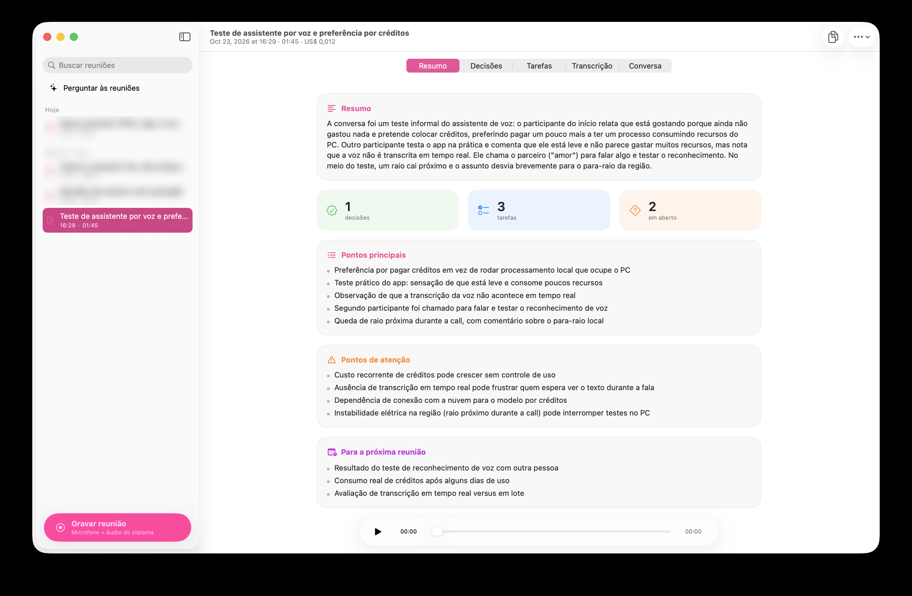
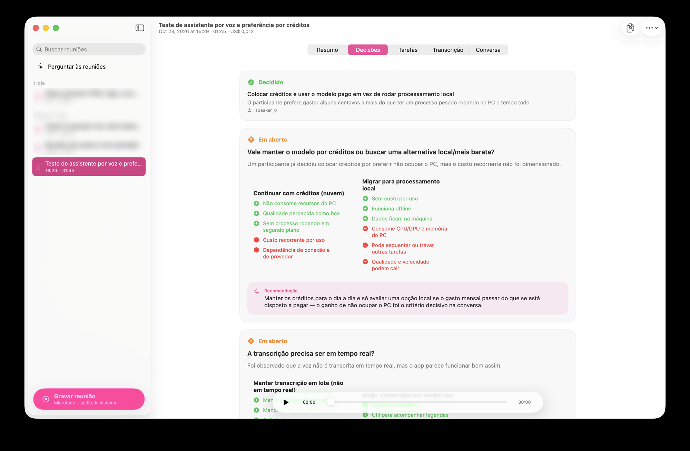
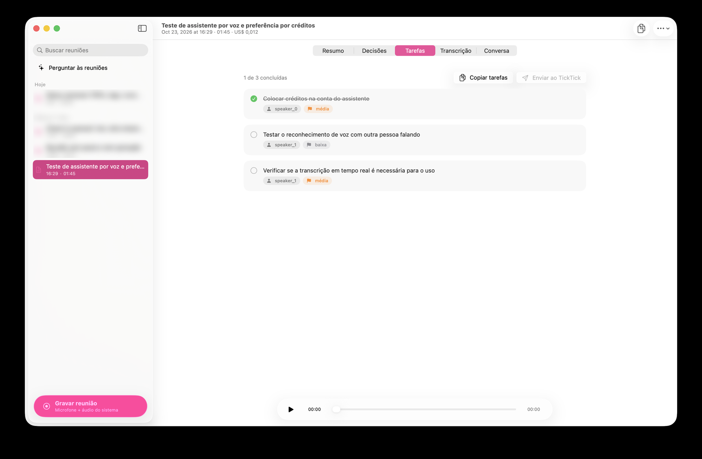
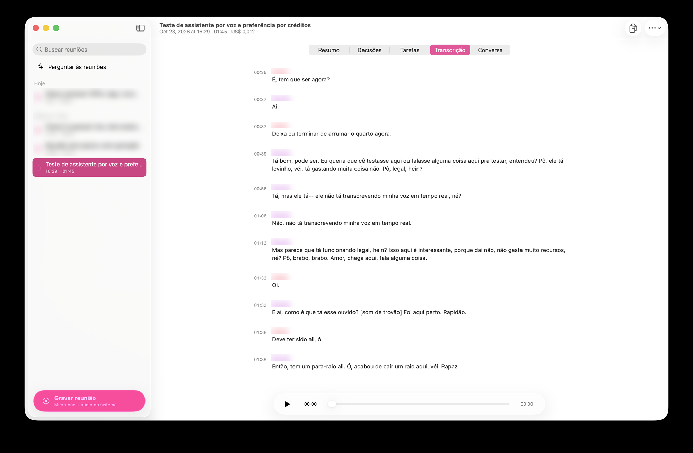

# Pauta

App de barra de menus para macOS que grava suas reuniões (microfone + áudio do sistema), transcreve e gera resumo, decisões e tarefas com IA.

A transcrição pode rodar 100% no Mac (Apple Speech, grátis e ao vivo) ou na nuvem via [OpenRouter](https://openrouter.ai), com identificação de quem está falando. O resumo e o chat com as reuniões usam o modelo de linguagem que você escolher no OpenRouter.



## Funcionalidades

- **Gravação** do microfone e do áudio do sistema (participantes da chamada), com atalho global `⌥⌘R`
- **Ilha no notch** com o estado da gravação e legenda ao vivo opcional
- **Três modos de transcrição**: local (Apple, ao vivo), nuvem (OpenRouter, com diarização) ou híbrido (ao vivo + refinado na nuvem)
- **Resumo, decisões, tarefas e transcrição** geradas por IA para cada reunião
- **Conversa** com a reunião e **"Perguntar às reuniões"** para buscar em todo o histórico
- Player de áudio, busca, exportação em Markdown e abertura automática ao iniciar a sessão
- A chave da API fica no Keychain do macOS

| Decisões | Tarefas |
| --- | --- |
|  |  |



## Requisitos

- macOS 26+
- Swift 6.2 (Xcode 26) e [just](https://github.com/casey/just)
- Uma chave do [OpenRouter](https://openrouter.ai/keys), só necessária para o modo nuvem, resumos e chat

## Instalação

```sh
git clone https://github.com/eduumach/pauta.git
cd pauta
just setup-signing   # uma vez: cria uma identidade de assinatura local
just install         # compila e copia para /Applications
```

O `setup-signing` evita que o macOS peça permissões (microfone, gravação de tela, Keychain) a cada build. Sem ele o app é assinado ad-hoc e funciona, mas as permissões são pedidas de novo.

Depois abra **Ajustes**, cole a chave do OpenRouter e escolha o modo de transcrição.

## Comandos

| Comando | O que faz |
| --- | --- |
| `just build` | Compila e monta `build/Pauta.app` |
| `just run` | Compila e abre o app |
| `just install` | Instala em `/Applications` |
| `just icon` | Regenera o ícone do app |

## Modelos padrão

- Transcrição na nuvem: `elevenlabs/scribe-v2`
- Resumo e chat: `~deepseek/deepseek-flash-latest`

Ambos podem ser trocados nos Ajustes por qualquer modelo disponível no OpenRouter.

## Estrutura

```
Sources/Pauta/
├── App/       # ponto de entrada e estado global
├── Audio/     # gravação, transcrição local e utilitários de áudio
├── AI/        # cliente do OpenRouter, resumo e chat
├── Island/    # ilha no notch
├── Models/    # reunião, decisões, tarefas
├── Storage/   # persistência, preferências e Keychain
├── Support/   # atalho global, player, exportação
└── UI/        # telas SwiftUI
```

## Roadmap

- Envio de tarefas para TickTick e Todoist (a interface já existe, a integração ainda não)

## Versionamento

As versões seguem [CalVer](https://calver.org) no formato `AAAA.MM.MICRO` (ex.: `2026.10.0`). O número `MICRO` sobe a cada release dentro do mesmo mês.

O binário das releases é assinado ad-hoc, sem notarização. Ao baixar o `.zip`, remova a quarentena antes de abrir:

```sh
xattr -dr com.apple.quarantine Pauta.app
```

## Contribuições

O Pauta é um projeto pessoal, feito para resolver um problema meu. Por enquanto **não aceito pull requests**. Sinta-se à vontade para fazer um fork e adaptar ao seu uso.

## Licença

[MIT](LICENSE)
